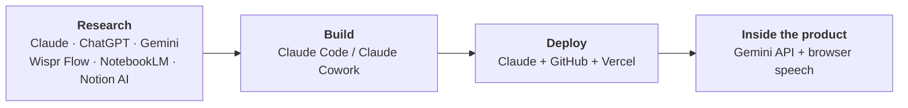
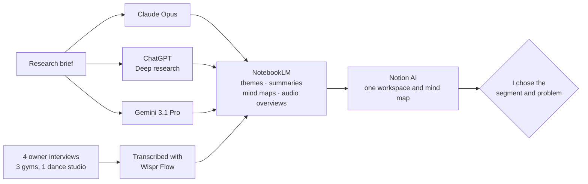
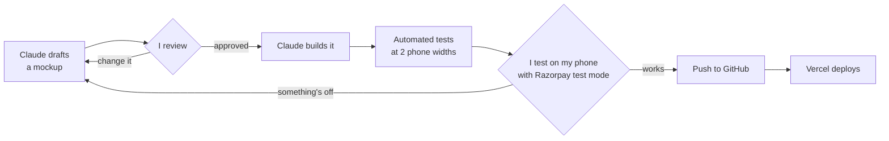
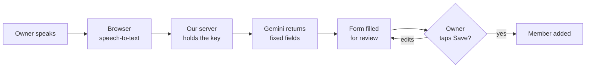
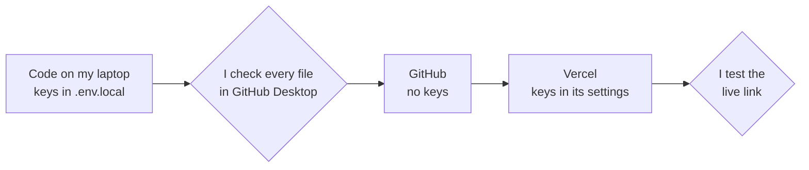
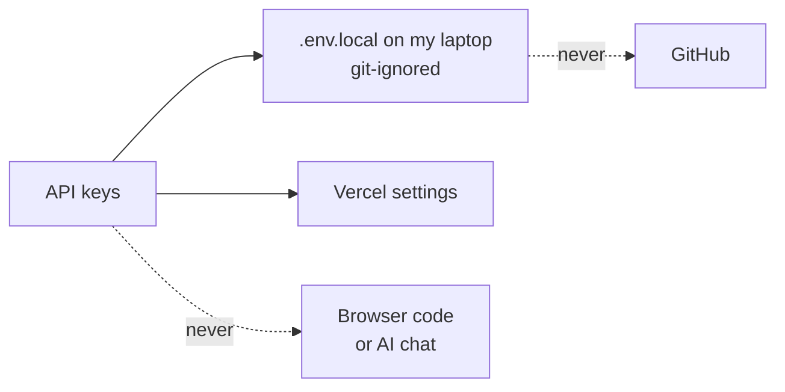
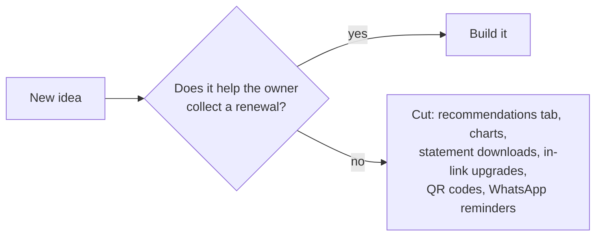
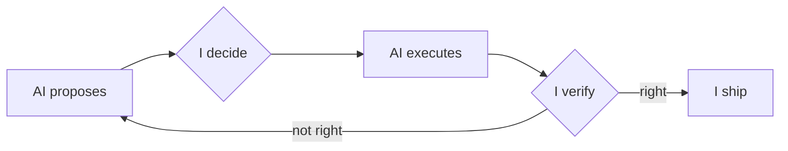
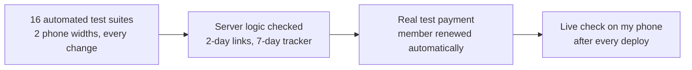

# AI Build Log: Memberships for Razorpay

**Razorpay AI × PM Build Challenge · Track 1: Razorpay in Your Pocket (Full Stack Builder)**
Harsh Agrawal, ISB PGP · Live prototype: https://pocket-razor.vercel.app

> **In one line:** AI was my execution team (researcher, designer, engineer and tester). I was the decision maker at every step.



---

## 1. AI tools and models

| Stage | Tool | Model | Used for |
|---|---|---|---|
| Research | **Claude** (Anthropic) | Claude Opus | Market research (Research mode) |
| | **ChatGPT** (OpenAI) | ChatGPT with Think on | Market research (Deep research), as a cross-check |
| | **Gemini** (Google) | Gemini 3.1 Pro | Market research (Deep Research), as a cross-check |
| | **Wispr Flow** | Built-in speech model | Transcribing owner interviews |
| | **NotebookLM** (Google) | Gemini (built in) | Common themes, summaries, mind maps, audio overviews |
| | **Notion AI** | Built in | One research workspace and a full mind map |
| Build | **Claude Code / Claude Cowork** | Claude Opus | Mockups, all code, automated tests |
| Deploy and docs | **Claude** | Claude Opus | GitHub and Vercel setup, product note, this log |
| In the product | **Gemini API** | gemini-flash-latest (falls back to flash-lite) | Turning a spoken sentence into form fields |
| | **Browser speech recognition** | Web Speech API, Indian English | Voice to text before Gemini |

---

## 2. AI for research



- **Three models, one brief:** each searches different sources, so they cross-check each other. A claim made by only one model was checked against its source before I used it.
- **Real owners, not just reports:** four interviews tested the desk research. *Names withheld for privacy.*
- **What we learned:** member details sit in registers or Excel; payments arrive as cash or UPI with no record of who paid for which month; members forget to pay, so owners chase them one WhatsApp at a time; nothing flags an expiring plan. Value gyms and studios are about 80% of India's fitness facilities (Deloitte × HFA, 2025), and about one in three members leave every year (HFA, 2025).
- **The decision:** these businesses run on members paying each cycle, not on autopay. So the product makes **every renewal a one-tap Razorpay payment link**, tied to the right member and plan.

---

## 3. Key prompts

Every prompt follows the same structure: **role → context → goal → tasks → constraints → output format.** *Cleaned up for readability. Click to expand.*

<details>
<summary><b>3.1 Deep research brief</b> (the same prompt in Claude, ChatGPT and Gemini)</summary>

```text
ROLE
You are a senior market research analyst specialising in Indian small-business
payments and fintech.

CONTEXT
I am a product manager building a new feature for the Razorpay merchant mobile app.
Razorpay already offers Payment Links, Subscriptions (autopay) and Invoices. I want
to find merchants who collect recurring fees but do NOT use subscription autopay,
and understand why.

GOAL
Identify, size and understand the Indian membership businesses (gyms, yoga and
dance studios, coaching classes, sports clubs and similar) that collect fees by hand.

RESEARCH QUESTIONS
1. Which membership segments are largest, and how fast are they growing?
2. How do owners manage members and collect fees today (tools, channels, cash vs UPI)?
3. Why is autopay adoption low among these merchants and their customers?
4. Where do owners lose time and revenue (missed renewals, follow-ups, reconciliation)?
5. What software do they use today, and what gaps does it leave?

CONSTRAINTS
- Focus on India; prefer sources from 2023 onwards.
- Cite every figure with its source and date. Never invent numbers.
- Clearly separate facts from estimates, and flag sources that disagree.

OUTPUT FORMAT
1. Executive summary (5 bullets)
2. Segment table: segment, size, growth, how they collect today
3. Pain points ranked by how common and how costly they are
4. Current tools and their gaps
5. Open questions to test with real owners
6. Full source list
```
</details>

<details>
<summary><b>3.2 Synthesis in NotebookLM</b> (three reports and four interview transcripts as sources)</summary>

```text
ROLE
You are a product researcher turning raw research into clear product insight.

CONTEXT
The sources are three deep research reports on Indian membership businesses
(from Claude, ChatGPT and Gemini) and four interview transcripts with
independent owners (three gyms, one dance studio).

GOAL
Build one clear picture of the problem: where the sources agree, where they
differ, and what owners said that the desk research missed.

TASKS
1. List the recurring themes, and how many sources support each one.
2. Summarise each owner's pain points in their own words.
3. Show where the reports and the interviews agree or contradict each other.
4. Point out the gaps: what owners raised that the reports missed, and the reverse.
5. Rank the top three problems by how often they occur, how urgent they are,
   and how much revenue they affect.

CONSTRAINTS
- Use only the uploaded sources, and cite a source for every claim.
- Quote owners directly where it helps; label anything that is inferred.

OUTPUT FORMAT
Short tables for tasks 1, 3 and 5; bullet points for tasks 2 and 4.
```
*Mind Map and Audio Overview were then generated from the same notebook.*
</details>

<details>
<summary><b>3.3 Base prompt for building the prototype</b> (Claude)</summary>

```text
ROLE
You are a senior full-stack engineer and product designer who knows Razorpay's
Blade design system and builds mobile-first React apps.

CONTEXT
I am adding a new product, "Memberships", under Products > Share and collect in the
Razorpay merchant app (screenshot attached). It is for independent gym and studio
owners who track members in registers and collect fees by cash or UPI.

GOAL
A working, phone-sized prototype that feels native to Razorpay and sends real
Razorpay payment links in test mode.

SCOPE (VERSION 1)
In: membership plans; members (added by form or by voice); expiring and expired
lists; send payment links by SMS; track link payments; record cash; a "collected
this month" view.
Out: autopay, invoices, and changes to any other product in the app.

WORKING RULES
1. Mockup first. Write no code until I approve the mockup.
2. Use Blade components and design tokens only.
3. API keys stay on the server, never in browser code or the repository.
4. AI voice input only fills the form; the owner confirms before anything is saved.
5. After each feature, run automated browser tests at two phone widths.
6. Explain things in plain language; I am not a full-time developer.

TECH STACK
React + Vite, Razorpay Blade, Vercel serverless functions,
Razorpay Payment Links API, Gemini API for voice-to-form.

OUTPUT FOR EACH FEATURE
Mockup > (my approval) > code > test results > list of files changed.
```
</details>

<details>
<summary><b>3.4 Deployment guidance</b> (Claude)</summary>

```text
ROLE
You are a DevOps engineer guiding a first-time deployer.

CONTEXT
My app is React + Vite with serverless API functions in an /api folder. The code
is on GitHub (pushed with GitHub Desktop). It needs three secrets: a Gemini API
key and a Razorpay test key ID and secret.

GOAL
A live, secure public URL on Vercel that redeploys every time I push to GitHub.

TASKS
1. Walk me from GitHub to a live Vercel deployment.
2. Tell me where to add environment variables, and exactly which ones.
3. List what must never be committed, and check my .gitignore.
4. Show me how to confirm that no secret ended up in the built app.
5. Explain how to check a deployment worked, and how to fix common failures.
6. Flag free-plan limits that affect my app (for example, scheduled jobs).

CONSTRAINTS
- Assume the free Hobby plan.
- One step at a time, in beginner language; wait for my confirmation.
- Never ask me to paste a key into this chat.

OUTPUT FORMAT
A numbered checklist, saying what I should see on screen after each step,
followed by a short troubleshooting table.
```
</details>

---

## 4. Workflow and agent setup

### The build loop: no code before an approved mockup



**How Claude was set up:** as an agent in its own cloud workspace (code editor, terminal, browser), so it could build, run and test the app itself. It worked from screenshots of the real Razorpay app, the base prompt (3.3) and the product rules I added along the way. Every round ended with a list of changed files for me to review and push.

### Gemini inside the product: AI fills, the owner decides



**Guardrails:** a fixed output format · only the merchant's existing plans can be picked · understands Indian speech ("double nine" = 99) · never invents details · retries and a lighter fallback model · "Type instead" always available.

<details>
<summary>The instruction Gemini runs on (excerpt)</summary>

```text
You fill in a "New member" form for a small Indian business (gym, studio, classes)
on Razorpay. The merchant describes a new member in their own words, often
transcribed speech, so expect small transcription errors. Today is <date in IST>.

The merchant's plans:
- id "p3": "Gold gym" (every 1 month for ₹1499; every 3 months for ₹3999; ...)

Extract:
- phone: digits only, as spoken. Indian speakers say "double nine" for 99 and
  "triple eight" for 888. Drop "+91" or a leading 0.
- planId: the id of the plan the merchant clearly means. Never invent an id.
- alreadyPaid: true only if the merchant says the member has already paid.
Never make up details the merchant didn't say.
```
</details>

### Deployment



- **Free-plan workaround:** Vercel's free plan runs scheduled jobs only once a day, too slow to catch payments. So the app checks Razorpay itself, every minute while open and whenever the owner returns.
- **A blocked deployment** was traced, with Claude's help, to the project being paused on Vercel. Resuming it and redeploying fixed it.

---

## 5. AI output I rejected or corrected

AI is fast and eager to add more. My corrections pushed the other way: **safer, simpler, narrower.**

### 5.1 Security: no secrets in GitHub



- **The easy path** puts keys in the app's code, and a folder with a key file is one careless commit from public GitHub.
- **My rule, before any code was written:** keys stay on the server, out of the repository and out of the chat. I checked every commit by hand, replaced the `.gitignore`, and had the built app scanned for keys.
- **Damage limited anyway:** free tier with billing off, and Razorpay in test mode, so a leaked key can't cost money.

### 5.2 Simple over overwhelming

The first **"Collected this month"** screen tried to show everything: a long scrolling page with a total, a "Due" figure, a Razorpay line, a "Send links" button and every payment.

| I asked | What changed |
|---|---|
| "It should fit one screen." | Payments moved to their own page; the overview fits one phone screen |
| "On what basis is it 'due'?" | It was an estimate presented as fact, so it's now **Expected by 31 Oct** |
| "How do we know what came through Razorpay?" | Split into **Via Razorpay · verified** and **Cash/UPI · recorded by you**, and **Record cash payment** added |
| "Isn't 'Send links' redundant?" | Removed; the action already lived on the member lists |

**The same rule everywhere:** two filters on the payments page (how it was paid, name search) · one **Edit** link instead of a row of buttons · one main button per member · one word ("Ends") with colour for urgency · no clutter lines or extra page titles.

### 5.3 Depth over breadth



- **One job, end to end,** then the product was frozen on purpose.
- **Built on Razorpay, not rebuilt:** Payment Links for payments; autopay left to Subscriptions, billing to Invoices.
- **Honest about scope:** other product cards say *"Not in scope for this prototype"*.
- **Plans change only at renewal,** so there are no refunds or part-payments mid-cycle.

---

## 6. What AI did vs what I decided



| Stage | AI executed | I decided and checked |
|---|---|---|
| **Research** | Deep research, transcription, themes, mind maps | Wrote the brief, interviewed four owners, chose the segment |
| **Scope** | Proposed features | Chose one job, cut the rest, froze the product |
| **Product rules** | Turned rules into logic | Link or cash on every renewal; plans change only at renewal; fair dates both ways; verified and recorded money never mixed |
| **Design** | Mockups in Razorpay's Blade design system | Approved or reworked every one before any code |
| **Engineering** | All the code and integrations | Set the constraints (Blade only, keys on the server, reuse Payment Links); reviewed every change |
| **Testing** | Automated tests after every change | Tested every flow on my phone with real test payments; reported bugs |
| **Deployment** | Explained GitHub, Vercel and env variables | Owned the keys, checked every commit, deployed every version |
| **Metrics** | Drafted options | Chose the north star (renewals collected through Memberships) and guardrail (on-time renewal rate) |

**Impact:** roughly **55–70 hours of work done in 10–12 hours of my time** (about 5–6× faster, estimated). The time saved went into talking to owners, testing on a real phone and deciding what to leave out.

---

## 7. Limitations, risks and verification

| Limitation today | For production |
|---|---|
| No database: data resets on reload | A database |
| Payments checked every minute while the app is open | Razorpay webhooks |
| Razorpay test mode: simulated payments, limited links | Live mode |
| Sample members share one demo number | Real merchant data |
| Cash is self-reported (shown separately from verified payments) | Same, kept separate |
| Voice needs Chrome or Safari ("Type instead" works everywhere) | Native speech in the app |
| Gemini free tier can be busy (retries and fallback cover it) | Paid tier |
| Four interviews shaped the problem | Wider merchant validation |

| Risk | Guardrail |
|---|---|
| AI research gets a fact wrong | Three models cross-checked, plus interviews; every figure sourced |
| Gemini mishears or invents | Fixed fields, existing plans only, owner confirms before saving |
| Keys leak | Server only, every commit checked, free tier and test mode (5.1) |
| A payment renews a member twice | Each paid link applied once; cash marks open links as handled |
| AI-written code hides bugs | Automated tests plus my own testing on a phone |

**How it was verified:**



---

*No API keys, credentials, private data or proprietary information are included in this log.*
